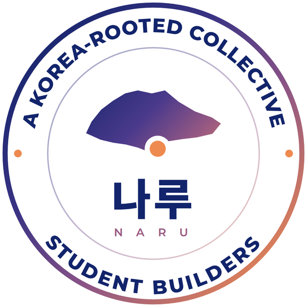
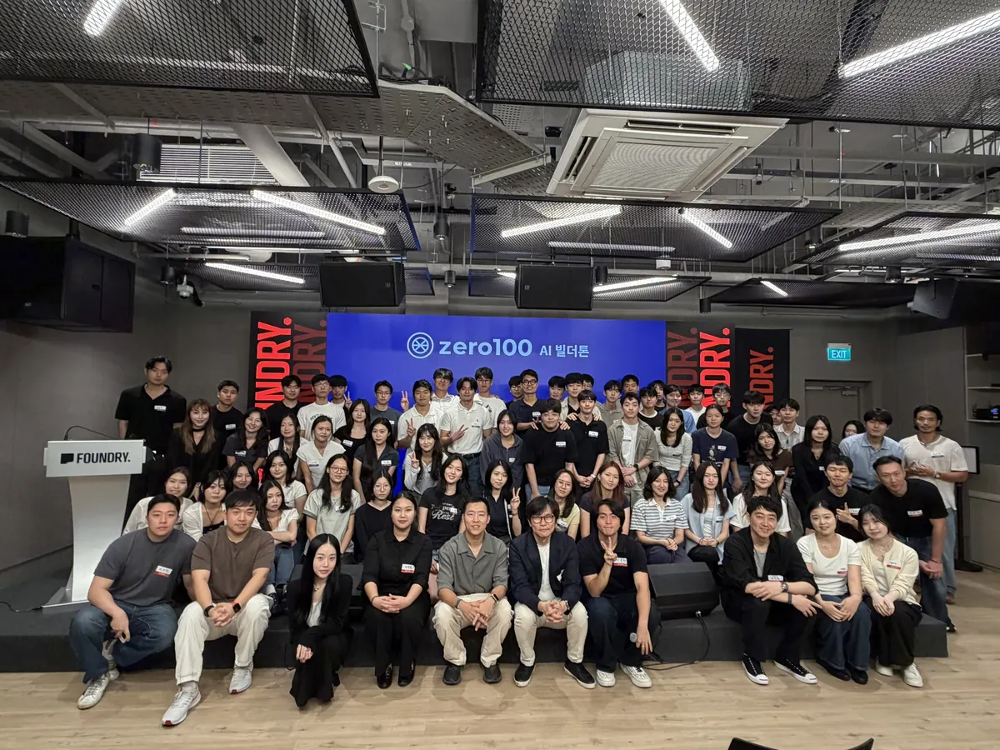
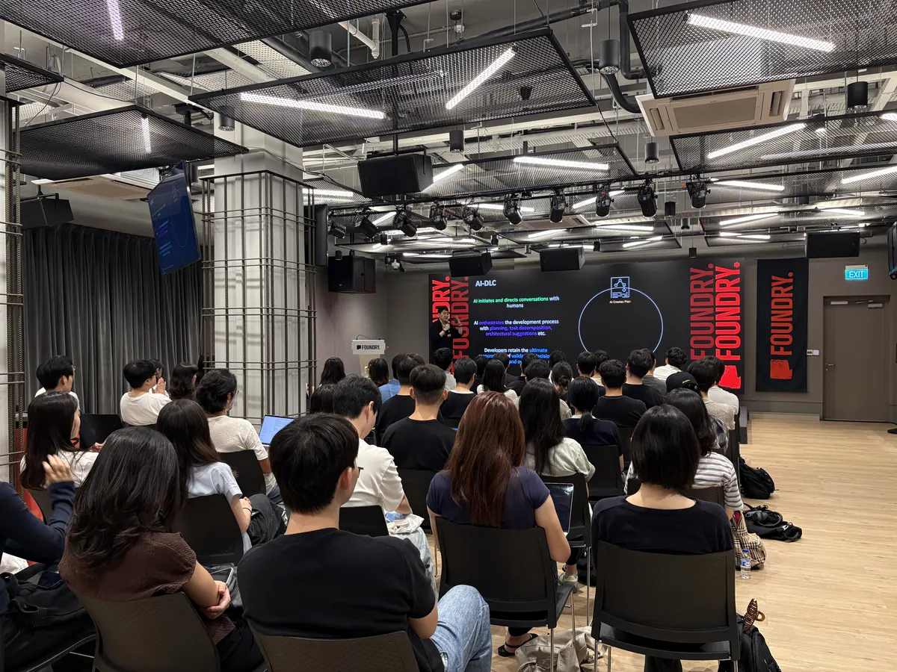
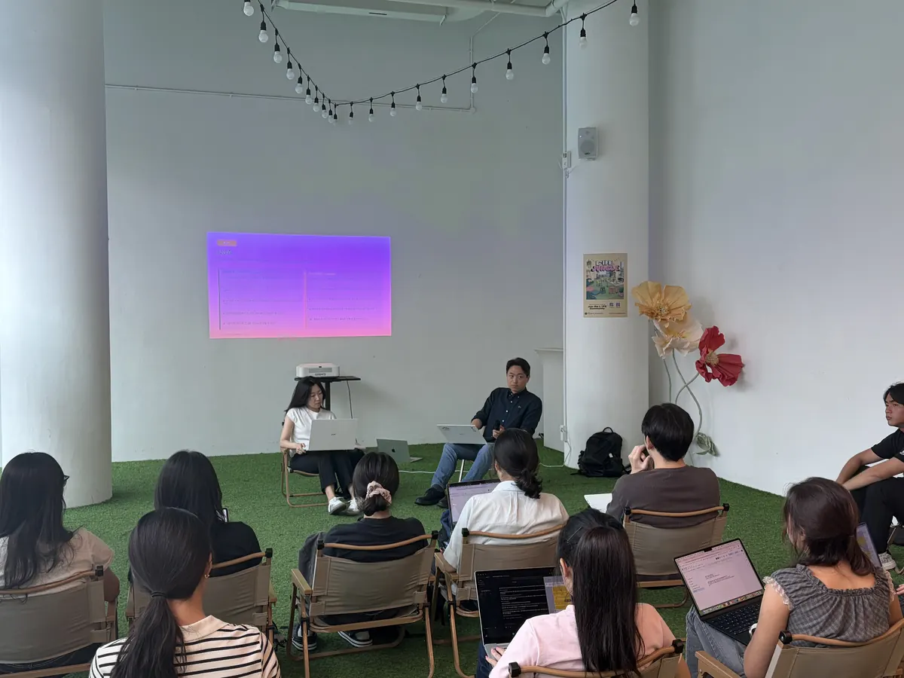
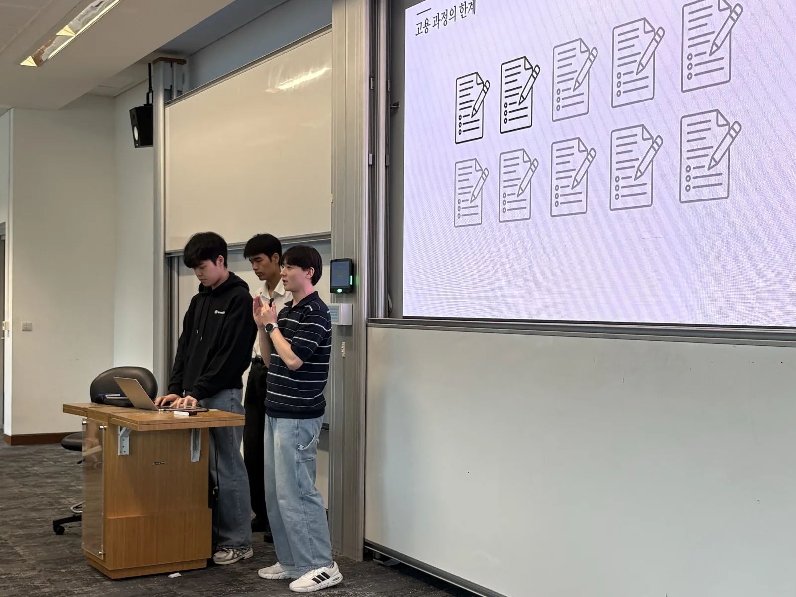
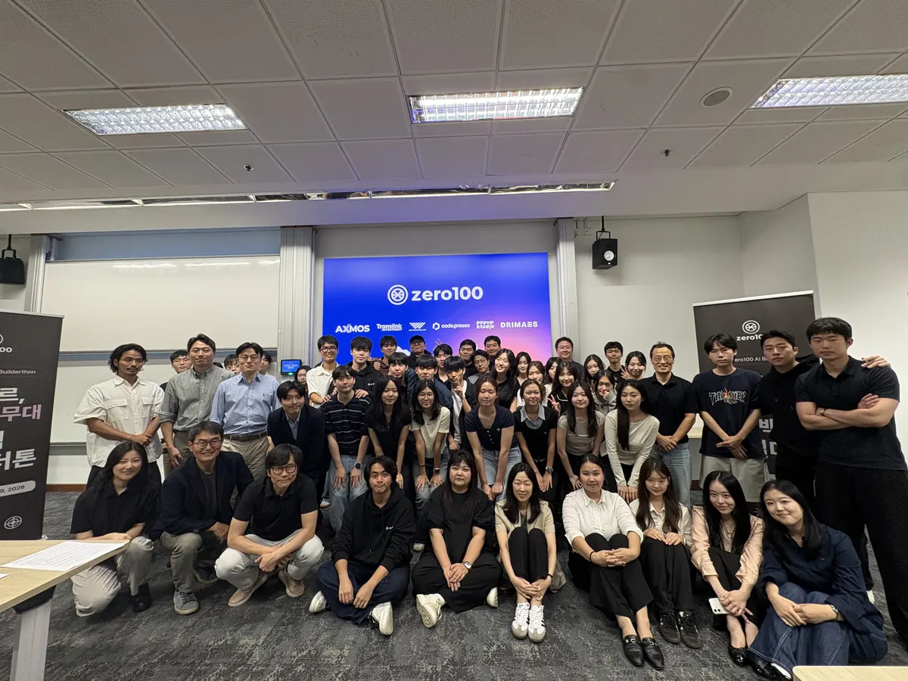

<p align="center">
  <picture>
    <source media="(prefers-color-scheme: dark)" srcset="public/naru/naru-master-v3-rev.png">
    
  </picture>
</p>

# 나루 NARU 웹사이트

**나루**는 한국에 뿌리를 두고 학생이 직접 운영하는, 영리를 목적으로 하지 않는 학생 빌더 그룹입니다(A Korea-rooted collective of student builders). 이 레포는 나루의 공식 사이트이고, 지금 홈은 2026년 12월 서울에서 여는 **크로싱 서울 CROSSING SEOUL**을 알립니다.

> 건너는 건 각자가 한다. 자리는 우리가 만든다.

## 변하지 않는 두 개

무엇이 바뀌어도 이 둘은 바뀌지 않습니다. 이벤트, AI, 기간, 형식은 전부 이 둘을 실행하는 방법입니다.

<table>
  <tr>
    <td width="50%" valign="top">
      <sub><b>CORE 01</b></sub>
      <h3>안전하게 도전할 수 있는 자리</h3>
      <i>A safe place to try something new</i>
      <br><br>
      스크리닝하지 않습니다. 순위를 매기지 않습니다. 못해도 되는 자리입니다. 여기서 잘하지 못한 것은 어디에도 기록되지 않고, 끝까지 해본 것은 남습니다.
    </td>
    <td width="50%" valign="top">
      <sub><b>CORE 02</b></sub>
      <h3>자기 가치를 증명해 보는 경험</h3>
      <i>A chance to prove your own worth</i>
      <br><br>
      모의가 아니라 진짜 앞에 섭니다. 실명이 박힌 기업, 실제로 그 일을 하는 사람, 답이 정해지지 않은 문제. 그 앞에서 자기 판단으로 만들고, 그 경험을 증명하는 실물을 손에 쥐고 나갑니다.
    </td>
  </tr>
</table>

이 둘이 이벤트에서는 이렇게 보입니다.

| | CORE 01 안전하게 도전할 수 있는 자리 | CORE 02 자기 가치를 증명해 보는 경험 |
| --- | --- | --- |
| 8월, 제로백 빌더톤 | 스크리닝 없이 74명이 신청했고, 순위 없이 부문별로 시상했습니다 | 실제 기업의 문제를 8일 동안 풀고, 21팀이 마지막 날 그 기업 앞에서 발표했습니다 |
| 12월, 크로싱 서울 | 오는 사람이 참가자입니다. 1위, 2위, 3위에 의미를 두지 않습니다 | 기업이 지금 겪는 이슈에서 문제를 직접 찾고, 닷새째 그 기업 앞에서 발표합니다 |

무엇을 할지 고민될 때 묻는 것도 이 둘입니다. 이 방식이 안전하게 도전할 자리를 넓히는가, 자기 가치를 증명할 기회를 주는가.

<p align="center">
  
</p>
<p align="center"><sub>제로백 빌더톤 Day 1, 2026년 8월 22일 싱가포르</sub></p>

**제로백 빌더톤이 없었으면 나루도, 크로싱 서울도 없습니다. 그 8일을 만든 사람들에게 빚지고 시작합니다.**

- 사이트: https://naru-crossing-seoul.vercel.app
- 한국어와 영어 두 벌(KR/EN 전환)

*NARU is a Korea-rooted, student-run, not-for-profit group of student builders. This repo is its website. Two things do not change: a safe place to try something new, and a chance to prove your own worth. The home page introduces CROSSING SEOUL (17 to 21 December 2026, Seoul), and `/2026-08` keeps the record of the event the group grew out of, the Zero100 builderthon in Singapore, hosted by AXMOS member companies in the Zero100 community. Without the Zero100 builderthon there is no NARU and no CROSSING SEOUL. We begin owing the people who made those eight days.*

## 나루는

나루는 강을 건너려는 사람이 배를 타는 자리입니다. 건너는 일은 각자가 합니다. 나루는 건널 수 있는 자리를 만들고, 건너간 사람이 다시 돌아와 서는 자리도 같은 나루입니다.

시작은 싱가포르였습니다. 학교마다 한인 학생이 있는데 학교를 가로질러 잇는 자리가 없었고, 선배가 후배에게 남기고 가는 것도 없었습니다. 경쟁이 치열할수록 학점, 인턴, 졸업, 오퍼처럼 눈앞의 칸부터 채우게 되고, 나는 어디로 나아갈 수 있는지를 물을 시간은 없습니다. 문을 두드리는 법은 대개 절박해진 다음에 배웁니다. 나루는 그 자리를 앞당겨 만듭니다. 절박하지 않아도 시작할 수 있도록.

무엇이 바뀌어도 바뀌지 않는 것은 위의 [둘](#변하지-않는-두-개)입니다. 이벤트는 이 둘을 실행하는 지금의 방식이고, 어젠다와 형식은 바뀝니다.

나루를 만드는 주체는 언제나 학생입니다. 먼저 겪은 선배가 후배가 설 판을 깔고, 그 자리에서 자란 사람이 다음 회차를 엽니다. 일하는 구조는 세 층입니다.

| 층 | 누구 | 내는 것 |
| --- | --- | --- |
| 주최 | 나루 | 회차의 기획과 실행, 기록, 회차 사이의 연속성 |
| 주관 | 각 학교 한인 학생회와 학회 | 소속 학생, 공간, 학교 안의 명의 |
| 후원 | 참여 기업 | 이슈와 자료, 자금, 멘토 |

학생회와 기업은 나루에서 직접 만나고, 진심으로 교류합니다. 나루는 회비를 받지 않고 가입 폼도 두지 않습니다. 참가자가 들어오는 길은 회차 하나입니다.

전문은 [매니페스토](public/naru/naru-manifesto-v4-2026-10.pdf)에 있습니다.

## 8월, 제로백 빌더톤

나루가 시작된 이벤트입니다. Zero100 커뮤니티에 속한 AXMOS 소속 회사들이 주최했고, 2026년 8월 22일부터 29일까지 싱가포르에서 8일이었습니다. 위 표의 세 층은 나루가 직접 여는 회차(크로싱 서울부터)의 구조입니다.

스크리닝 없이 실제 기업의 문제를 받아 8일 동안 풀었고, 마지막 날 그 기업 앞에서 발표했습니다.

<p align="center">
  
  
  
</p>
<p align="center"><sub>Day 1 쉰아홉 명으로 시작했습니다. Day 5 세션. Day 8 앞에서 증명했습니다.</sub></p>

| | |
| --- | --- |
| 74명 | 신청 |
| 59명 | Day 1 참석 |
| 25팀 | 시작 |
| 21팀 | 마지막 날 발표 |
| 9팀 | 출제사에 직접 자료를 요청. 시키지 않았습니다 |

순위는 매기지 않았고 부문별로 시상했습니다. 행사가 끝난 뒤 출제사의 보도자료가 CNA와 The Straits Times에 게재됐습니다.

### 빚지고 시작합니다

제로백 빌더톤이 없었으면 나루도, 크로싱 서울도 없습니다. 나루의 변하지 않는 두 개가 그 8일에서 나왔습니다. 그 8일을 만든 분들입니다.

- 문제를 낸 기업
- 소속과 별개로 개인 자격으로 저녁 시간을 낸 멘토들
- 무대에 선 연사와 전문가
- 1:1 멘토링을 위해 회관을 내어준 싱가포르 한인회
- 각 학교 한인 학생회 운영진
- 그리고 8일을 건너 마지막 날 앞에 선 21팀

그 이름들이 지금의 나루를 만들었습니다. 고맙습니다.

<p align="center">
  
</p>
<p align="center"><sub>Day 8, 시상식이 끝난 뒤</sub></p>

기록 전체는 [/2026-08](https://naru-crossing-seoul.vercel.app/2026-08)에 있습니다.

## 8월에서 12월로

8월의 두 장면(스크리닝 없이 진짜 문제를 받은 것, 마지막 날 그 기업 앞에 선 것)이 나루의 변하지 않는 두 개가 됐습니다. 크로싱 서울은 그 둘을 그대로 잇는 나루의 두 번째 이벤트입니다. 한 번으로는 사례가 되지 않고, 두 번째부터 선례가 됩니다.

8월을 치르고 남은 아쉬움 다섯과 12월의 답입니다.

| 8월 | 12월 |
| --- | --- |
| 출제사가 문제 접근법까지 정리해서 줬고, 팀마다 만든 것이 비슷했습니다 | 만들어야 하는 것과 그것이 어디에 적용되는지까지 학생이 정의합니다 |
| 멘토링 슬롯은 넉넉했는데 한 번도 쓰지 않은 팀이 있었습니다 | 멘토링의 디테일을 사전에 더 많이 공유합니다 |
| 팀 안에서는 붙었지만 팀과 팀은 섞이지 않았습니다 | 모든 활동을 대면으로 합니다. 다른 팀이 만드는 것을 현장에서 직접 봅니다 |
| 주관 학생이 함께 자랄 자리가 없었습니다 | 주관 학생도 성과 공유회에서 발표할 수 있습니다. 시상 대상은 아닙니다 |
| 끝난 뒤 멘토에게 먼저 연락한 팀은 한 팀이었습니다 | 끝난 뒤 멘토에게 먼저 연락하는 법까지 안내합니다 |

넓어지는 것은 둘입니다.

- **판.** 8월은 싱가포르 안에서 열렸습니다. 12월은 한국의 대학생, 해외에서 공부하는 한인 학생, 8월을 싱가포르에서 건넌 사람들이 한 팀이 됩니다. 등록은 모두 혼자 하고, 팀은 Day 1 현장에서 전원이 함께 맺습니다.
- **문제를 찾는 방식.** 8월은 출제사가 완성한 문제를 받았습니다. 12월은 기업이 지금 겪는 이슈를 받습니다. 공개된 정보를 AI로 모아 추론하고, 팀마다 그 아래의 문제를 직접 찾습니다.

## 12월, 크로싱 서울

2026년 12월 17일(목)부터 21일(월)까지, 서울. 기업이 지금 겪는 이슈를 받아 그 아래에서 일이 막히는 지점 하나를 문제로 정하고, 그 병목만 푸는 툴을 만들어 마지막 날 그 기업 앞에서 발표하는 닷새입니다. 상을 받을 결과물보다 문제에 다가가는 과정이 남도록, 날마다 할 일과 장치를 큐레이션했습니다. 세부는 기획 단계라 바뀔 수 있고, 장소와 Day 0 안내는 참가자 카카오톡 방에서 알립니다.

### 이슈, 문제, 만드는 것

8월에는 출제사가 정리한 문제를 받았고 팀마다 만든 것이 비슷했습니다. 많은 팀이 업무 흐름 전체를 바꾸는 큰 시스템을 만들어 왔습니다. 12월은 출발점과 만드는 것의 크기를 나눠 둡니다.

| | 이슈 | 문제 | 만드는 것 |
| --- | --- | --- | --- |
| 무엇 | 기업이 지금 답답해하지만 원인도 답도 아직 정해지지 않은 넓은 상황 | 그 이슈의 원인 중 팀이 고른 병목 하나. 업무 흐름의 어느 단계에서 누가 무엇에 막히는가 | 그 병목만 푸는 작은 툴. 업무 흐름 전체를 바꾸는 시스템이 아님 |
| 누가, 언제 | 출제사가 Day 0에 엽니다 | 팀이 Day 1에 정하고 Day 2, 3에 현업 멘토에게 확인받습니다 | 팀이 Day 3에 만듭니다 |
| 묻는 것 | 무엇이 안 되나 | 왜, 어디서 안 되나 | 풀렸는지 무엇으로 보나(숫자 하나) |
| 예 | "채용 업무에 AI를 붙이고 싶은데 어디에 붙여야 할지 모르겠다" | 서류 검토 단계에서 담당자가 지원서마다 필수 요건을 직접 확인하느라 가장 오래 걸린다 | 필수 요건을 먼저 걸러 주는 툴. 지원서 한 건당 검토 시간으로 확인 |

예는 설명을 위해 만든 것입니다. 정형 데이터와 함께 줄 수 있는 문제는 이제 AI가 읽어 기업이 안에서 풉니다. 학생에게 열 수 있는 것은 아직 답이 없는 이슈이고, 같은 이슈를 받아도 팀마다 다른 병목을 고를 수 있습니다.

### 닷새

| 날 | 스테이지 | 하는 일 | 세션 | 손에 남는 것 |
| --- | --- | --- | --- | --- |
| Day 0, 12.17 목 | 컨텍스트 열기 Context Open | 출제사가 이슈와 기대한 효과, 회사 소개, 자료가 어디 있는지를 엽니다. 자료는 정리해서 주지 않습니다 | | 각자 세운 첫 생각 |
| Day 1, 12.18 금 | 찾기 Find | 현장에서 팀을 맺고, 출제사의 세션에서 회사를 봅니다. 팀이 병목 하나를 골라 문제로 정합니다 | Lovable workshop | 팀의 생각 1장(이슈, 문제, 만들 툴, 확인할 숫자) |
| Day 2, 12.19 토 | 확인받기 Check | 고른 병목이 현장에서도 정말 막히는 곳인지 멘토를 찾아가 확인받습니다 | PO session | ★ 미션: 멘토 찾아가기와 진척 공유 |
| Day 3, 12.20 일 | 만들기 Build | 그 병목만 푸는 툴을 만들고, 정한 숫자로 확인하고, 틀리는 경우를 찾아 한계로 적습니다 | Open tables | ★ 미션: 멘토 찾아가기와 Open tables 공유. 덱을 포함한 사전 제출물 |
| Day 4, 12.21 월 | 공유하기 Share | 성과 공유회. 이슈를 낸 기업 앞에서 고른 병목과 만든 툴, 어디까지 갔는지를 발표하고 질의를 받습니다 | | 부문별 시상, 트랙별 인기투표 |

스테이지마다 그날의 어젠다에 맞는 3시간짜리 세션이 붙습니다. Day 1부터 Day 4까지는 모두 아침부터 저녁까지 현장에서 열립니다.

### 장치와 그 이유

장치마다 두 질문에 답합니다. 안전하게 도전할 자리를 넓히는가(CORE 01), 자기 가치를 증명할 기회를 주는가(CORE 02).

| 장치 | 어떻게 | 왜 |
| --- | --- | --- |
| 스크리닝 없음 | 학점도 이력서도 보지 않습니다. 오는 사람이 참가자입니다 | 문턱에서 거르지 않고 안에서 빨리 알아봅니다(CORE 01) |
| 이슈로 출제 | 기업은 정리된 문제 대신 지금 겪는 이슈와 자료의 위치를 엽니다 | 8월에는 완성된 문제를 받아 결과물이 서로 닮았습니다. 문제를 찾아 정의하는 구간부터 학생에게 엽니다(CORE 02) |
| 병목 하나, 작은 툴 | 문제는 한 단계, 한 사람의 막힘으로 좁히고, 그것만 푸는 툴을 만듭니다 | 닷새 안에 만들고 숫자 하나로 확인할 수 있는 크기입니다. 현업이 문제에 다가가는 방식을 익힙니다 |
| 혼자 등록, 현장 팀 구성 | 팀은 Day 1 현장에서 전원이 맺습니다. 모든 팀에 해외에서 공부하는 학생과 여러 학교 학생이 섞입니다 | 아는 사람이 없어도 시작할 수 있습니다(CORE 01). 학교나 나라끼리 겨루는 대항전이 아닙니다 |
| 팀의 생각 1장 | 이슈, 문제, 만들 툴, 확인할 숫자의 네 칸. Day 1에 쓰고 Day 2, 3에 들고 갑니다 | 질문 목록이 아니라 자기 판단을 먼저 꺼내 놓는 연습입니다. 멘토와 같은 틀로 이야기합니다 |
| 찾아가는 멘토링 | Day 2, 3에 팀이 멘토가 있는 곳으로 갑니다. 모든 팀이 같이 보는 시간표(`/crossing/team`)로 예약하고, 한 칸은 40분, 하루 두 칸까지입니다 | 8월에는 멘토링 자리가 넉넉했는데 한 번도 쓰지 않은 팀이 있었습니다. 먼저 다가가 자기 이야기를 하는 것도 익힐 것입니다 |
| 멘토가 묻는 질문 넷 | 어떤 AI 기능을 붙일까, 누구의 어떤 일이 바뀌나, 먼저 해 본 시도는 어디서 멈췄나, 어떻게 가장 작게 확인할까 | 멘토는 답을 주러 오지 않습니다. 행사가 끝난 뒤에도 스스로 답할 수 있는 질문을 남깁니다 |
| 미션 | Day 2와 Day 3에 하나씩. 팀원 과반이 현장에, 멘토 찾아가기(이틀 중 하루 이상), 그날의 진척 공유(Day 2는 PDF, Day 3은 Open tables) | 무엇을 냈는가보다 함께 있었는가를 봅니다. 해낸 팀은 모두 그날 지원을 받고, 1위 한 팀에게 몰아 주지 않습니다. 진척 PDF는 과정의 기록으로 남습니다 |
| 세션 셋 | Lovable workshop(만드는 손), PO session(무엇을 왜 만들지), Open tables(막힌 곳을 다른 팀에 묻기) | 그날 할 일에 맞춥니다. Open tables는 8월에 팀과 팀이 섞이지 않았던 것을 메우는 자리입니다 |
| 성과 공유회 | 이슈를 낸 기업 앞에서 발표하고 질의를 받습니다. 다 풀지 못했어도 무대에 섭니다 | 모의가 아니라 그 이슈의 주인 앞에 섭니다(CORE 02) |
| 무순위 부문별 시상, 트랙별 인기투표 | 등수 대신 부문별로 시상하고, 참가자가 트랙마다 기억에 남는 팀 하나를 고릅니다(`/crossing/vote`) | 결과보다 과정을 봅니다. 서로 다른 강점이 드러날 자리를 여럿 둡니다(CORE 01) |
| 끝난 뒤 먼저 연락하기 | 멘토에게 무엇을 만들었는지 한 줄로 먼저 연락합니다. 제목은 인사가 아니라 결과 | 8월에 끝난 뒤 멘토에게 먼저 연락한 팀은 한 팀이었습니다. 이어 가는 것은 각자의 몫이고, 그 첫 줄을 현장에서 안내합니다 |

이슈를 낸 기업에게는 팀마다 다른 병목을 고른 기록이 남습니다. 기업은 공개할 수 있는 자료만 열고, Day 1에 맥락을 풀고, Day 4에 질의합니다.

## 그 이후

- **크로싱은 이어지는 이름입니다.** 크로싱이 이벤트의 이름이고 뒤의 도시가 회차를 구분합니다. 다음이 어디서 열리든 크로싱 [도시]가 됩니다. 다음 도시와 시기는 아직 정해지지 않았습니다.
- **형식은 바뀌어도 됩니다.** 8일이 닷새가 됐듯이, 어젠다도 형식도 그때 학생이 배워야 할 것을 따라갑니다. 새 방식을 고를 때 묻는 것은 둘입니다. 안전하게 도전할 자리를 넓히는가, 자기 가치를 증명할 기회를 주는가.
- **이벤트에서 커뮤니티로.** 이벤트로 학생을 모으고, 모인 사람들을 커뮤니티로 잇고, 각 나라의 학생회, 학회와 함께 서울과 싱가포르를 넘어 더 넓게 다가갑니다.
- **사람이 바뀌어도 남게.** 한 사람에게 주어진 시간은 길어야 1년입니다. 그래서 처음부터 승계를 전제로 설계합니다. 받은 사람이 다음 회차에 돌려주러 오는 자리를 남겨 둡니다.
- **남기는 것은 사람의 이야기입니다.** 결과물은 그 자리에서 소비되고 대부분 잊힙니다. 회차마다 거기서 나온 사람의 이야기를 기록합니다.

---

아래는 이 레포에 대한 안내입니다.

## 무엇이 있나

| 주소 | 내용 |
| --- | --- |
| `/` | 홈. 크로싱 서울 소개, 프로그램, 참가 |
| `/naru` | 그룹 나루. 변하지 않는 두 개, 8월 요약, 어떻게 일하는가 |
| `/match` | 크로싱 서울 Day 1 현장 팀 매칭용 AI 유형 테스트 |
| `/2026-08` | 제로백 빌더톤(2026년 8월, 싱가포르)의 기록. 나루가 시작된 이벤트이고 끝난 회차입니다 |
| `/quiz` | 8월 팀 매칭에 쓴 유형 테스트 |
| `/crossing/team` | 크로싱 서울 멘토 시간표 예약과 미션 인증 |
| `/crossing/vote` | 성과 공유회 날의 트랙별 인기투표 |
| `/api/crossing/register` | 크로싱 서울 등록 |

등록 창은 아직 열지 않았습니다(`lib/registrationWindow.ts`의 `CROSSING_WINDOW`가 둘 다 `null`). 값을 채우면 홈의 등록 버튼이 켜집니다. 12월과 8월의 용어 규칙은 `data/naru.ts` 맨 위 주석에 있습니다.

## 기술

- **Next.js 15**(App Router), **TypeScript**, **Tailwind CSS**
- **Framer Motion**: 스크롤 리빌, 모달
- **three.js**: 홈 배경(밤의 강과 등불, 서울과 싱가포르 윤곽). `lib/background/`
- **Supabase**: 등록과 투표 저장. 서버 라우트에서만 service role 키로 씁니다
- **Cloudflare Turnstile**: 12월 등록 폼의 봇 확인
- **Vercel**: 배포, Analytics, Speed Insights

## 로컬에서 돌리기

Node 18.17 이상이 필요합니다.

```bash
npm install
cp .env.local.example .env.local   # 값은 아래 표 참고
npm run dev                        # http://localhost:3999
```

```bash
npm run build   # 먼저 scripts/check-changelog.mjs가 돕니다
npm run start   # http://localhost:3999
```

dev 서버가 도는 동안 같은 폴더에서 `npm run build`를 돌리지 마세요. `.next`를 같이 써서 dev가 깨집니다.

### 환경 변수

| 이름 | 쓰는 곳 |
| --- | --- |
| `NEXT_PUBLIC_SUPABASE_URL` | Supabase 프로젝트 주소 |
| `SUPABASE_SERVICE_ROLE_KEY` | 서버 전용. `lib/supabaseAdmin.ts`만 읽습니다. `NEXT_PUBLIC_`를 붙이지 마세요 |
| `NEXT_PUBLIC_TURNSTILE_SITE_KEY` | Turnstile 사이트 키(공개 값) |
| `TURNSTILE_SECRET_KEY` | 서버 전용. 없으면 개발에서는 확인을 건너뛰고 운영에서는 503을 돌려줍니다 |

키가 없어도 화면은 뜹니다. 등록과 투표 API만 동작하지 않습니다. 표 구조는 `supabase/migrations/`에 있습니다.

## 어디를 고치나

카피와 화면을 나눠 둡니다. 화면에 보이는 문장은 전부 `{ ko, en }` 쌍이고, 컴포넌트는 `useLocale()`의 `t()`로 읽습니다.

| 바꾸려는 것 | 파일 |
| --- | --- |
| 홈(`/`)의 모든 문장 | `data/naru.ts` |
| 크로싱 서울의 이름과 날짜 | `lib/naruDates.ts` (단일 출처. 다른 곳에 날짜를 적지 않습니다) |
| 등록 창이 열리고 닫히는 시각 | `lib/registrationWindow.ts` |
| 12월 등록 폼의 문항 | `data/crossingForm.ts` |
| 홈의 배치와 챕터 | `components/home/NaruHome.tsx` |
| 헤더와 목차 | `components/journey/JourneyNav.tsx`, `data/naru.ts`의 `naruNav` |
| 배경 | `lib/background/` (`config.ts`가 수치) |
| 8월 기록(`/2026-08`)의 문장과 일정 | `data/dictionary.ts`, `data/schedule.ts` |
| 나루 로고 | `public/naru/` (같은 폴더 README에 출처와 규칙) |
| README의 로고와 사진 | `docs/readme/`(밝은 화면용 로고), `public/naru/`(어두운 화면용), `public/record/`(8월 사진) |
| 이름, 정의문, 변하지 않는 두 개의 문장 | `docs/brand.md` (브랜드 정본. 여기부터 바꿉니다) |
| 색과 서체 | `tailwind.config.ts`, `app/globals.css` |
| 사이트 주소와 메타데이터 | `app/layout.tsx`, `app/sitemap.ts`, `app/robots.ts` |

`data/naru.ts`와 `data/dictionary.ts`는 섞지 않습니다. 앞은 나루 그룹의 정본이고 뒤는 8월 회차의 정본입니다.

## 일하는 규칙

전문은 `CLAUDE.md`에 있습니다.

- 체인지로그는 레포 루트의 `CHANGELOG.md` 하나입니다. 새 항목은 맨 위에 씁니다. 다른 체인지로그 파일이 있으면 빌드가 실패합니다.
- 결정은 코드 주석에 `DECIDED YYYY-MM-DD`로 남깁니다. 아직 확정되지 않은 것은 지어내지 않고 `TODO: confirm`으로 표시합니다.
- em dash 문자를 쓰지 않습니다.
- 큰 변경은 `docs/`에 브리프를 두고, 브리프의 검증을 마친 뒤에 푸시합니다.
- 사람 이름, 연락처, 참가자 개인 정보를 체인지로그와 문서에 쓰지 않습니다.

## 배포

`main`에 푸시하면 Vercel이 프로덕션으로 배포합니다. 그래서 검증을 마친 뒤에 푸시합니다.

## 구조

```
app/
  page.tsx               홈(크로싱 서울)
  naru/                  그룹 나루
  match/                 현장 팀 매칭
  2026-08/               제로백 빌더톤 기록
  quiz/                  유형 테스트
  api/                   등록, 투표 라우트
  layout.tsx             메타데이터, 서체, 로케일
components/
  home/                  홈(NaruHome, RecordTabs)
  crossing/              12월 등록 모달과 Turnstile
  journey/               헤더, 챕터, 8월 페이지
  shared/, ui/           같이 쓰는 조각
data/                    카피 정본(naru, dictionary, schedule, crossingForm, quiz)
lib/
  background/            three.js 배경
  naruDates.ts           12월 이름과 날짜
  registrationWindow.ts  등록 창
  supabaseAdmin.ts       서버 전용 Supabase 클라이언트
docs/                    브리프와 감사 기록
scripts/                 빌드 전 검사, 배경 형상 굽기, 로고 처리
supabase/migrations/     표 정의
public/                  로고, 사진, 서체
```
