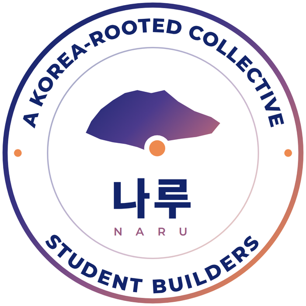
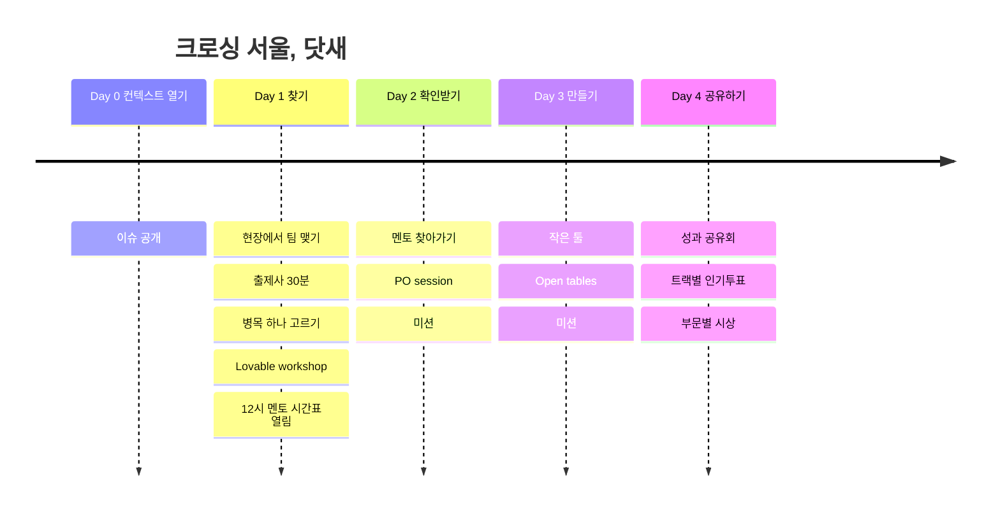
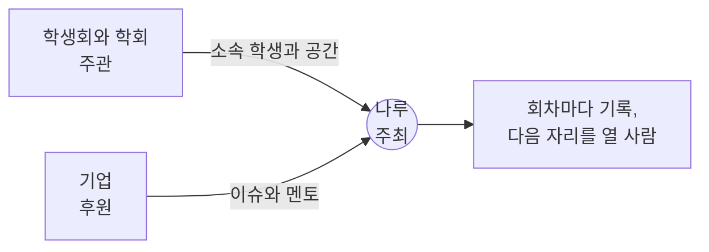
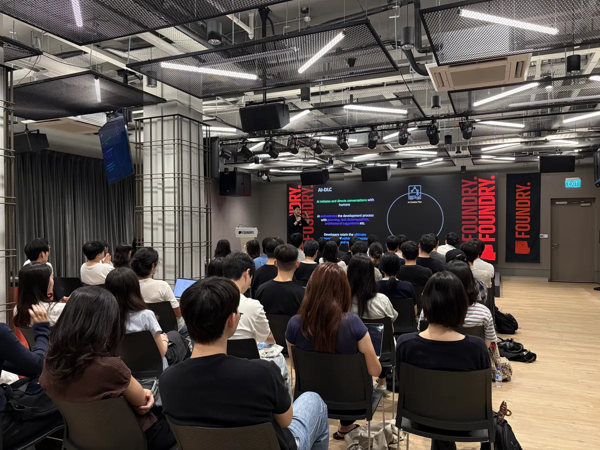
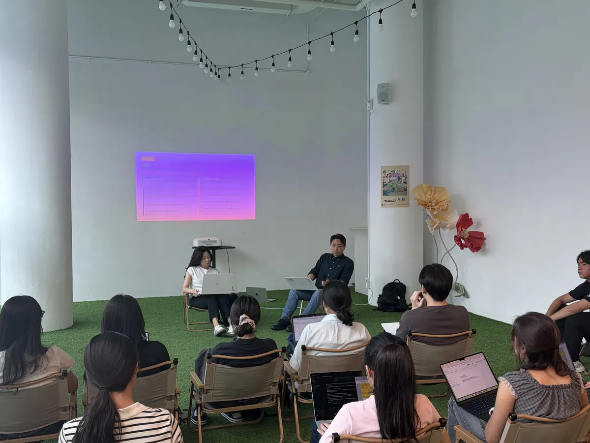
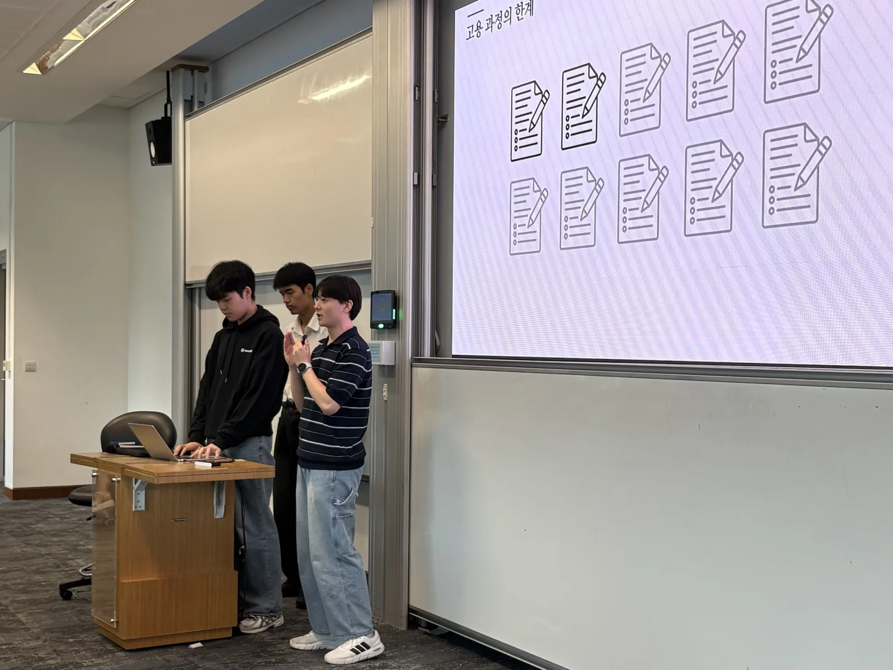
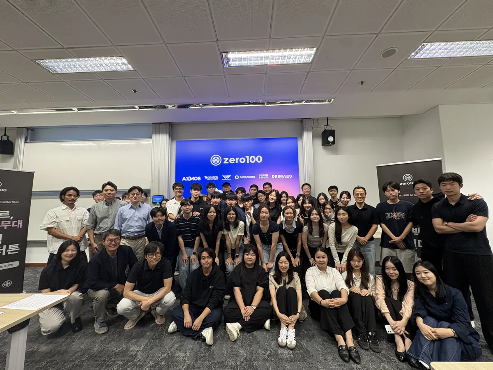
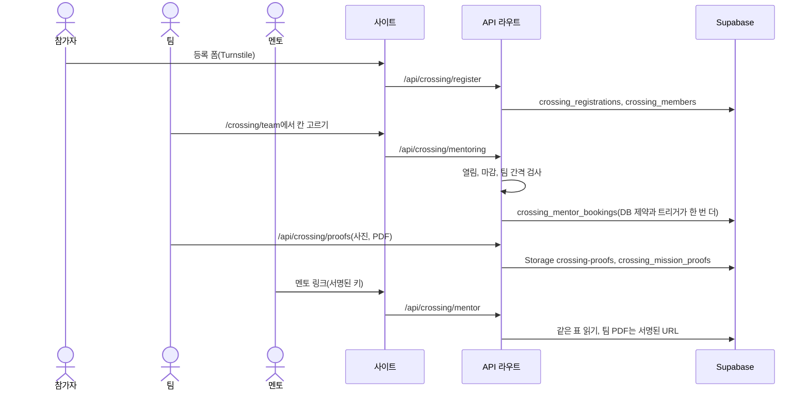

<p align="center">
  <picture>
    <source media="(prefers-color-scheme: dark)" srcset="public/naru/naru-master-v3-rev.png">
    
  </picture>
</p>

# 나루 NARU 웹사이트

**나루**는 한국에 뿌리를 두고 학생이 직접 운영하는, 영리를 목적으로 하지 않는 그룹입니다. 이벤트로 학생을 모으고, 모인 사람들을 진짜 커뮤니티로 잇습니다. 이 레포는 나루의 공식 사이트이고, 나루가 직접 여는 첫 자리 **크로싱 서울 CROSSING SEOUL**(2026년 12월 17일부터 21일까지, 서울)을 함께 담습니다.

> 처음엔 다 서툽니다.<br>건너기 전에 연습부터.

사이트: https://naru-crossing-seoul.vercel.app (한국어와 영어, KR/EN 전환)

*NARU is a Korea-rooted, student-run, not-for-profit group. This repo is its website and the home of CROSSING SEOUL.*

## 화면

*What the site looks like today.*

<table>
  <tr>
    <td width="50%"></td>
    <td width="50%"></td>
  </tr>
  <tr>
    <td><sub>나루 홈 <code>/</code></sub></td>
    <td><sub>크로싱 서울 <code>/crossing</code></sub></td>
  </tr>
  <tr>
    <td></td>
    <td></td>
  </tr>
  <tr>
    <td><sub>멘토 시간표와 미션 인증 <code>/crossing/team?day=2</code></sub></td>
    <td><sub>8월 기록 <code>/2026-08</code></sub></td>
  </tr>
</table>

<details>
<summary>폰(390px)에서</summary>
<br>
<p>
  
  
  
  
</p>
</details>

<sub>2026-11-09에 배포본을 첫 화면만 찍었습니다. 사람 이름과 얼굴이 보이는 자리(시간표 머리, 8월 연사)는 README용 그림에서만 흐렸습니다. 화면이 크게 바뀔 때 다시 찍습니다.</sub>

## 변하지 않는 두 개

*Two things that do not change.*

무엇이 바뀌어도 이 둘은 바뀌지 않습니다. 이벤트, AI, 기간, 형식은 전부 방법입니다. 아래 두 문장은 `docs/brand.md` 2장의 정본 그대로입니다.

<table>
  <tr>
    <td width="50%" valign="top">
      <sub><b>CORE 01</b></sub>
      <h3>안전하게 도전할 수 있는 자리</h3>
      <i>A safe place to try something new</i>
      <br><br>
      자기 아이디어를 말하지 못하는 것이 아니라, 판단받지 않고 말해 볼 자리가 없었을 뿐이다. 여기서는 점수를 매기지 않고, 현업에 있는 사람들이 끝까지 들어 준다.
    </td>
    <td width="50%" valign="top">
      <sub><b>CORE 02</b></sub>
      <h3>자기 가치를 증명해 보는 경험</h3>
      <i>A chance to prove your own worth</i>
      <br><br>
      기업은 증명하라고 하지만 학생에게는 내밀 것이 없고, 혼자 만든 것으로는 증명이 되지 않는다. 여기서는 기업의 이슈로 만들고 멘토와 고쳐, 화면에 띄워 보여 줄 것을 들고 나간다.
    </td>
  </tr>
</table>

이 둘이 이벤트에서는 이렇게 보입니다.

| | CORE 01 안전하게 도전할 수 있는 자리 | CORE 02 자기 가치를 증명해 보는 경험 |
| --- | --- | --- |
| 8월, 제로백 빌더톤 | 스크리닝 없이 74명이 신청했고, 순위 없이 부문별로 시상했습니다 | 실제 기업의 문제를 8일 동안 풀고, 21팀이 마지막 날 그 기업 앞에서 발표했습니다 |
| 12월, 크로싱 서울 | 오는 사람이 참가자입니다. 점수를 매기지 않고, 현업 멘토가 끝까지 듣습니다 | 기업이 아직 손으로 하는 일을 이슈로 받아 병목 하나를 찾고, 마지막 날 그 기업 앞에서 발표합니다 |

무엇을 할지 고민될 때 묻는 것도 이 둘입니다. 이 방식이 안전하게 도전할 자리를 넓히는가, 자기 가치를 증명할 기회를 주는가. 둘 다 아니라면 우리 것이 아닙니다.

## 크로싱 서울, 닷새

*CROSSING SEOUL: five days, Day 0 to Day 4.*

2026년 12월 17일(목)부터 21일(월)까지, 서울. 기업이 아직 사람 손으로 하는 일 하나가 이슈입니다. 팀은 그 일의 흐름에서 누가 어느 단계에서 무엇에 막히는지 병목 하나를 문제로 고르고, 그 병목만 푸는 작은 툴을 만들어 마지막 날 그 기업 앞에서 발표합니다. 결과물보다 과정을 봅니다.



| 날 | 단계 | 하는 일 | 세션 | 장소 | 미션 |
| --- | --- | --- | --- | --- | --- |
| Day 0, 12.17 목 | 컨텍스트 열기 Context Open | 어느 기업이 어떤 이슈로 오는지 미리 엽니다. 자세한 설명은 Day 1에 출제사가 직접 합니다 | | | |
| Day 1, 12.18 금 | 찾기 Find | 현장에서 팀을 맺고, 병목 하나를 골라 팀의 생각 1장을 먼저 씁니다 | Lovable workshop | FASTFIVE | 없음. 1장은 Day 2에 들고 갑니다 |
| Day 2, 12.19 토 | 확인받기 Check | 왜 그 병목인지 멘토를 찾아가 설명하고, 일을 해 본 사람의 반박을 듣습니다 | PO session | | ★ 있음 |
| Day 3, 12.20 일 | 만들기 Build | 그 병목만 푸는 작은 툴을 만들고, 기업이 가져다 쓸 수 있을지 멘토에게 묻습니다 | Open tables (Zoom) | | ★ 있음 |
| Day 4, 12.21 월 | 공유하기 Share | 성과 공유회. 이슈를 낸 기업 앞에서 고른 병목과 만든 툴을 발표하고 질의를 받습니다 | | MARU180 | 없음 |

Day 1부터 Day 4까지는 아침부터 저녁까지 현장에서 열립니다. 등록은 2026년 11월 16일(월)에 엽니다(아래 [어디를 고치나](#어디를-고치나)의 등록 창 참고).

## 장치와 그 이유

*Each device answers one of the two questions.*

장치마다 두 질문에 답합니다. 안전하게 도전할 자리를 넓히는가(CORE 01), 자기 가치를 증명할 기회를 주는가(CORE 02).

| 장치 | 어떻게 | 왜 |
| --- | --- | --- |
| 스크리닝 없음 | 학점도 이력서도 보지 않습니다. 오는 사람이 참가자입니다 | 입구에서 거르지 않고 안에서 빨리 알아봅니다(CORE 01) |
| 이슈로 출제 | 이슈는 기업이 아직 사람 손으로 하는 일 하나입니다. 30분 통화로 듣고 운영팀이 한 장으로 정리합니다 | 8월에는 완성된 문제를 받아 결과물이 서로 닮았습니다. 문제를 찾는 구간부터 학생에게 엽니다(CORE 02) |
| 병목 하나, 작은 툴 | 문제는 누가 어느 단계에서 무엇에 막히는지 한 문장. 만드는 것은 그 병목만 푸는 툴이고, 효과는 숫자 하나로 봅니다 | 닷새 안에 만들고 확인할 수 있는 크기입니다. 현업이 문제에 다가가는 방식을 익힙니다 |
| 혼자 등록, 현장 팀 | 팀은 Day 1 현장에서 전원이 맺습니다. 한국의 대학생과 해외에서 공부하는 한인 학생이 같은 팀이 됩니다 | 아는 사람이 없어도 시작할 수 있습니다(CORE 01). 나라나 학교끼리 겨루는 대항전이 아닙니다 |
| 팀의 생각 1장 | Day 1에 팀이 먼저 쓰고, AI는 그 글을 고치는 데만 씁니다. Day 2, 3에 멘토에게 들고 갑니다 | AI가 쓴 것을 고치지 말고, 내가 쓴 것을 AI가 고치게. 자기 판단을 먼저 꺼내 놓습니다 |
| 찾아가는 멘토링 | Day 2, 3에 팀이 멘토가 계신 곳(오피스, 카페, 온라인)으로 갑니다. 한 칸은 40분, 정각에 시작하고 앞뒤 10분은 멘토가 쉽니다 | 멘토는 답을 주러 오지 않고, 일을 해 본 사람의 감각으로 반박합니다. 8월에는 멘토링 자리를 한 번도 쓰지 않은 팀이 있었습니다 |
| 멘토 칸 규칙 | 칸은 Day 1 12:00(KST)에 열립니다. 오전 칸(13:00 전 시작)은 전날에(Day 2는 Day 1 17:00, Day 3은 Day 2 14:00), 오후 칸은 그날 12:00에 닫힙니다. 칸 수는 제한이 없지만 같은 날 우리 팀의 다른 칸과 시작이 2시간 이상 떨어져야 하고, 넣은 칸은 바꾸지 않습니다 | 모든 팀이 한 번은 멘토를 만나고, 멘토에게 무리가 가지 않게. 멘토는 점심 뒤로 바뀌지 않는 표를 받고, 팀은 이동 시간을 둡니다 |
| 미션 | Day 2와 Day 3에만. 조건 넷: 팀원 과반이 현장에(Day 3은 Zoom에), 멘토 한 분 이상을 과반이 함께 찾아가기(사진), 그날 세션(PO session, Open tables)에 함께 있기, 1장을 반박에 맞춰 고쳐 올리기(Day 3은 발표 자료 PDF) | 무엇을 냈는가보다 함께 있었는가를 봅니다. 해낸 팀은 모두 그날 세션이 끝난 뒤 지원을 받고, 1위 한 팀에게 몰아 주지 않습니다 |
| 세션 셋 | Lovable workshop(Day 1), PO session(Day 2), Open tables(Day 3, Zoom) | 그날 할 일에 맞춥니다. Open tables는 8월에 팀과 팀이 섞이지 않았던 것을 메우는 자리입니다 |
| 성과 공유회 | 이슈를 낸 기업 앞에서 발표하고 질의를 받습니다. 아이디어 단계여도 무대에 섭니다 | 그 이슈의 주인 앞에 섭니다(CORE 02) |
| 부문별 시상, 트랙별 인기투표 | 등수 대신 부문별로 시상하고, 참가자가 트랙마다 기억에 남는 팀 하나를 고릅니다(`/crossing/vote`) | 결과보다 과정을 봅니다. 서로 다른 강점이 드러날 자리를 여럿 둡니다(CORE 01) |
| 끝난 뒤 먼저 연락하기 | 멘토에게 먼저 연락합니다. 제목은 인사가 아니라 결과 | 8월에 끝난 뒤 멘토에게 먼저 연락한 팀은 한 팀이었습니다. 이어 가는 것은 각자의 몫이고, 현장에서 여러 번 말합니다 |

남는 것은 둘이고 한 물건의 양면입니다. 학생에게는 아직 손으로 하는 일이 왜 손으로 남았는지부터 생각하는 힘, 기업에는 그 일에 가져다 쓸 수 있는 작은 툴. 가져다 쓸 수 있는지까지 말하고, 쓴다고 약속하지 않습니다.

## 8월에서 12월로

*From August in Singapore to December in Seoul.*

8월의 두 장면(스크리닝 없이 진짜 문제를 받은 것, 마지막 날 그 기업 앞에 선 것)이 나루의 변하지 않는 두 개가 됐습니다. 크로싱 서울은 그 둘을 잇는 자리입니다. 한 번으로는 사례가 되지 않고, 두 번째부터 선례가 됩니다.

8월을 치르고 남은 아쉬움 다섯과 12월의 답입니다.

| 8월 | 12월 |
| --- | --- |
| 출제사가 문제 접근법까지 정리해서 줬고, 팀마다 만든 것이 비슷했습니다 | 무엇을 만들지, 어디에 적용할지까지 학생이 정의합니다 |
| 멘토링 슬롯은 넉넉했는데 한 번도 쓰지 않은 팀이 있었습니다 | 멘토 찾아가기를 Day 2, 3 미션에 넣고, 시간표를 모든 팀이 같이 봅니다 |
| 팀 안에서는 붙었지만 팀과 팀은 섞이지 않았습니다 | Day 3 Open tables에서 팀마다 어디까지 왔는지 나눕니다. Day 3(일요일)은 만들기와 Open tables를 Zoom으로 하고, 다른 날은 대면입니다 |
| 주관 학생이 함께 자랄 자리가 없었습니다 | 주관 학생도 성과 공유회에서 발표할 수 있습니다. 시상 대상은 아닙니다 |
| 끝난 뒤 멘토에게 먼저 연락한 팀은 한 팀이었습니다 | 끝난 뒤 멘토에게 먼저 연락하는 법까지 안내합니다 |

## 나루는

*NARU: the group, what the name means, and how it works.*

제로백 빌더톤에서 나루가 시작됐고, 크로싱 서울은 나루가 직접 여는 첫 자리입니다.

싱가포르에는 1,000명이 넘는 한인 유학생이 있지만, 이들을 대표해 온 학생 단체는 없었습니다. 선배가 후배에게 내려주는 것이 없고, 졸업한 사람이 남기고 가는 것이 없습니다. 경쟁이 치열할수록 눈앞의 칸(학점, 인턴, 졸업, 오퍼)부터 채우느라 나는 어디로 나아갈 수 있는가를 물을 시간이 없습니다. 이 이벤트가 주려는 가치를 주는 창구가 한국 청년에게 없어서, 나루가 그 창구가 됩니다. 절박하지 않아도 시작할 수 있도록.

이름의 뜻은 세 겹입니다.

1. **사람.** 한 사람이 누군가의 나루가 되어 줄 수는 있지만 그 사람은 졸업합니다. 그래서 사람이 바뀌어도 언제나 누군가의 나루가 되어 주는 그룹을 만듭니다.
2. **구조.** 주관으로 들어온 학생회와 후원으로 들어온 기업이 직접 만나지 않고 거쳐 가는 나루터. 그 자리가 이 그룹입니다.
3. **연습.** 건너기 전에 노 젓는 법을 익히는 곳. 노는 각자가 젓고, 나루는 그 전의 연습을 엽니다. 지금 익히는 노 젓는 법은 AI를 쓰는 법이고, 노가 바뀌면 익히는 것도 바뀝니다.



| 층 | 누구 | 내는 것 |
| --- | --- | --- |
| 주최 | 나루 | 회차의 기획과 실행, 기록, 회차 사이의 연속성 |
| 주관 | 각 학교 한인 학생회와 학회 | 소속 학생, 공간, 학교 안의 명의 |
| 후원 | 참여 기업 | 이슈와 자료, 멘토 |

나루는 회비를 받지 않고 가입 폼도 두지 않습니다. 참가자가 들어오는 길은 회차 하나입니다. 처음부터 승계를 전제로 설계합니다. 사람이 바뀌는 것은 사고가 아니라 기본값이고, 받은 사람이 다음 회차에 돌려주러 오는 자리를 남겨 둡니다.

전문은 나루 홈의 [매니페스토](https://naru-crossing-seoul.vercel.app/#join-ways)에 있습니다.

## 빚지고 시작합니다

*We begin owing the people who made those eight days.*

나루가 시작된 이벤트는 2026년 8월 22일부터 29일까지 싱가포르에서 열린 제로백 빌더톤입니다. Zero100 커뮤니티에 속한 AXMOS 소속 회사들이 주최했고, 스크리닝 없이 실제 기업의 문제를 받아 8일 동안 풀고 마지막 날 그 기업 앞에서 발표했습니다.

<p align="center">
  
  
  
</p>
<p align="center"><sub>Day 1 홀. Day 5 세션. Day 8 앞에서 증명했습니다.</sub></p>

| | |
| --- | --- |
| 74명 | 신청 |
| 25팀 | 시작 |
| 21팀 | 마지막 날 발표(84%) |
| 9팀 | 시키지 않았는데 출제사에 자료를 요청 |
| 4부문 10팀 | 수상. 순위는 매기지 않았습니다 |
| 14명 | 현업 멘토 |
| 네 학교 | NUS, NTU, SMU, Kaplan |

제로백 빌더톤이 없었으면 나루도, 크로싱 서울도 없습니다. 나루의 변하지 않는 두 개가 그 8일에서 나왔습니다. 그 8일을 만든 분들입니다.

- 문제를 낸 기업
- 소속과 별개로 개인 자격으로 저녁 시간을 낸 멘토들
- 무대에 선 연사와 전문가
- 1:1 멘토링을 위해 회관을 내어준 싱가포르 한인회
- 각 학교 한인 학생회 운영진
- 그리고 8일을 건너 마지막 날 앞에 선 21팀

그 이름들이 지금의 나루를 만들었습니다. 고맙습니다.

<p align="center">
  
</p>
<p align="center"><sub>Day 8, 시상식이 끝난 뒤. 기록 전체는 <a href="https://naru-crossing-seoul.vercel.app/2026-08">/2026-08</a>에 있습니다.</sub></p>

---

아래는 이 레포에 대한 안내입니다.

## 구조

*Routes, folders, and how data moves.*

| 주소 | 내용 |
| --- | --- |
| `/` | 나루 홈. 변하지 않는 두 개, 일하는 방식, 왜, 매니페스토 |
| `/crossing` | 크로싱 서울. 닷새, 남는 것, 함께하는 곳, 등록 |
| `/crossing/team` | 멘토 시간표(Day 2, 3)와 미션 인증 올리기(Day 1~3). `?day=n` |
| `/crossing/mentor` | 멘토 페이지. 멘토마다 받은 서명된 링크(`?k=`)로만 열립니다 |
| `/crossing/vote` | 성과 공유회 날의 트랙별 인기투표 |
| `/match` | Day 1 현장 팀 매칭용 AI 유형 테스트 |
| `/quiz` | 8월 팀 매칭에 쓴 유형 테스트 |
| `/2026-08` | 제로백 빌더톤(2026년 8월, 싱가포르)의 기록 |
| `/en/...` | 위 페이지의 영어판(`?lang=en`과 같음) |
| `/naru` | `/`로 영구 이동 |
| `/go/openchat/[src]` | 오픈채팅으로 보내는 중간 주소(어디서 들어왔는지 셈) |

| API | 하는 일 |
| --- | --- |
| `/api/crossing/register` | 크로싱 서울 등록(Turnstile 확인) |
| `/api/crossing/mentoring` | 시간표 읽기와 칸 넣기(마감과 팀 간격 검사) |
| `/api/crossing/proofs` | 미션 인증 사진과 PDF 올리기 |
| `/api/crossing/mentor` | 멘토 페이지 데이터(서명된 키 확인) |
| `/api/crossing/vote` | 트랙별 인기투표 |
| `/api/crossing/match` | `/match` 결과 저장 |

없는 주소는 `middleware.ts`가 `lib/fixPath.ts`로 고쳐 봅니다(끝에 붙은 괄호, 한글 별칭, 오타).

```
app/                     페이지와 API 라우트(위 표)
components/
  naru/redesign/         나루 홈 화면과 한국어 글(copy.ts)
  crossing/redesign/     크로싱 서울 화면과 한국어 글(copy.ts)
  crossing/              시간표(TeamTool), 멘토 페이지(MentorTool), 등록 모달, 하루의 흐름
  journey/, home/        8월 기록과 옛 홈(배포 화면 아님)
  shared/, ui/           헤더, 푸터, 로고 띠, 글자 크기
data/                    글의 정본(naru, crossingTeam, crossingForm, dictionary, schedule, quiz)
lib/                     날짜(naruDates), 등록 창, 시간표 규칙(crossingOps), Supabase 서버 클라이언트
supabase/migrations/     표 정의 0001~0022
docs/                    brand.md(브랜드 정본), 브리프, 감사 기록, README 그림
scripts/                 빌드 전 체인지로그 검사, 로고 처리, 명단 굽기
public/                  로고, 사진, 서체, 매니페스토
```



브라우저는 Supabase에 직접 닿지 않습니다. 모든 읽기와 쓰기는 서버 라우트가 service role 키로 하고, 표에는 RLS를 켜 두고 정책을 두지 않습니다.

## 기술

- **Next.js 15**(App Router), **React 19**, **TypeScript**, **Tailwind CSS**
- **Framer Motion**: 모달, 시트, 펼치기
- **Supabase**: Postgres(등록, 팀, 멘토 시간표, 인증, 투표)와 Storage(인증 파일, 출제사 자료)
- **Cloudflare Turnstile**: 등록 폼의 봇 확인
- **Vercel**: 배포, Analytics, Speed Insights
- `three`와 `lib/background/`는 남아 있지만, 2026-11-04 종이 화면부터 배경을 그리지 않습니다(`components/BackgroundMount.tsx`)

## 로컬에서 돌리기

Node 18.18 이상이 필요합니다(Next.js 15).

```bash
npm install
cp .env.local.example .env.local   # 이름은 아래 표 참고
npm run dev                        # http://localhost:3999
```

```bash
npm run build   # 먼저 scripts/check-changelog.mjs가 체인지로그가 하나인지 봅니다
npm run start   # http://localhost:3999
```

dev 서버가 도는 동안 같은 폴더에서 `npm run build`를 돌리지 마세요. `.next`를 같이 써서 dev가 깨집니다. 키가 없어도 화면은 뜹니다. 그 키를 쓰는 API만 동작하지 않습니다.

## 환경 변수

*Names and where they are read. No values here.*

<details>
<summary>열 개, 이름과 쓰는 곳</summary>
<br>

| 이름 | 쓰는 곳 | 서버 전용 |
| --- | --- | --- |
| `NEXT_PUBLIC_SUPABASE_URL` | `lib/supabaseAdmin.ts`. Supabase 프로젝트 주소 | |
| `SUPABASE_SERVICE_ROLE_KEY` | `lib/supabaseAdmin.ts`와 API 라우트. RLS를 건너뛰는 키라 `NEXT_PUBLIC_`를 붙이지 않습니다 | 예 |
| `NEXT_PUBLIC_TURNSTILE_SITE_KEY` | `components/crossing/RegisterModal.tsx`. 공개 값 | |
| `TURNSTILE_SECRET_KEY` | `lib/register/turnstile.ts`. 없으면 개발에서는 확인을 건너뛰고 운영에서는 503 | 예 |
| `TURNSTILE_ALLOWED_HOSTNAMES` | `lib/register/turnstile.ts`. 기본 목록 밖 호스트(프리뷰 등)를 쉼표로 | 예 |
| `MENTOR_LINK_SECRET` | `lib/crossingOpsServer.ts`. 멘토 링크의 키를 서명합니다 | 예 |
| `MATCH_ROOM_CODE` | `app/api/crossing/match/route.ts`. 값이 있으면 `/match`가 현장 방 코드를 요구합니다 | 예 |
| `NEXT_PUBLIC_MATCH_ROOM_CODE_ON` | `lib/crossingMatch.ts`. 화면에 방 코드 칸을 보일지 | |
| `NEXT_PUBLIC_SITE_URL` | `lib/siteUrl.ts`. 메타데이터와 사이트맵의 주소 | |
| `CROSSING_VOTE_OPEN` | `lib/crossingVote.ts`. 인기투표를 여는 스위치 | 예 |

</details>

## 데이터베이스

*Supabase tables and migrations, applied in order by the organisers.*

표는 마이그레이션 파일로만 만듭니다(대시보드 표 편집기로 만들지 않음). 새 표에는 `service_role` 권한을 같은 파일에 넣습니다. 적용은 운영진이 번호 순서대로 하고(`scripts/supabase-push.sh`), 멘토 시간을 바꾸는 파일은 적용 전 예약이 0건인지 먼저 봅니다. 파일과 표에는 사람 이름을 쓰지 않습니다(멘토는 번호).

주요 표: `crossing_registrations`, `crossing_members`, `crossing_teams`, `crossing_team_members`, `crossing_tracks`, `crossing_mentors`, `crossing_mentor_windows`, `crossing_mentor_bookings`, `crossing_mission_proofs`, `crossing_votes`, `crossing_match_profiles`. 8월 표는 `registrations`, `registration_members`, `day8_votes`. 운영진이 보는 뷰는 `crossing_participants`, `crossing_team_roster`, `crossing_mentor_timetable`, `crossing_mission_progress` 등입니다.

<details>
<summary>마이그레이션 0001~0022</summary>
<br>

| 파일 | 한 것 |
| --- | --- |
| 0001 | 8월 등록 표 |
| 0002 | 8월 등록 보안 강화 |
| 0003 | 8월 Day 8 참가자 투표 |
| 0004 | 크로싱 서울 등록 표 |
| 0005 | 등록의 전공과 AI 단계를 뷰에 |
| 0006 | 현장 팀 매칭용 AI 유형 결과 |
| 0007 | 매칭판 뷰에 id와 시각 |
| 0008 | 팀과 멘토 시간표, 인증 파일 버킷 |
| 0009 | Day 1 인증(PDF 하나) |
| 0010 | 흐름 점검 뒤 채운 것(팀의 트랙 등) |
| 0011 | 팀 짜기 명단의 같은 이름 문제 |
| 0012 | 트랙 표, 활동 기록마다 트랙, 멘토 자리 |
| 0013 | 미션은 Day 2와 Day 3에만 |
| 0014 | 인기투표를 트랙별로 차례로 |
| 0015 | 브라우저 역할의 남은 권한 걷기, 함수 search_path 고정 |
| 0016 | 넣은 칸이 끝난 뒤에 다음 칸(0022에서 걷음) |
| 0017 | 멘토는 하루의 반나절만 |
| 0018 | 이틀 통틀어 한 번에 한 칸(0022에서 걷음) |
| 0019 | 오후 반나절을 13:00~16:00으로, 점심 없음 |
| 0020 | 멘토 한 분의 오전을 9:00~12:00으로 |
| 0021 | 멘토 두 분의 날 바꿈 |
| 0022 | 칸 마감(오전은 전날, 오후는 그날 12:00), 팀 간격 2시간, 멘토 장소 |

</details>

## 어디를 고치나

*Where to change what. `docs/brand.md` is the source of truth for names and sentences.*

화면에 보이는 문장은 전부 `{ ko, en }` 쌍이고, 컴포넌트는 `useLocale()`의 `t()`로 읽습니다. 배포 화면의 한국어는 `copy.ts` 둘이 덮어쓰고, 영어와 한국어 기본값은 `data/naru.ts`에 있습니다. `copy.ts`의 목록은 `data/naru.ts`와 길이가 같을 때만 화면에 올라갑니다. 길이가 다르면 기본값이 조용히 보이므로, 목록을 늘리거나 줄일 때는 두 파일을 같이 고칩니다.

| 바꾸려는 것 | 파일 |
| --- | --- |
| 이름, 정의문, 변하지 않는 두 개, 금지어, 어휘 | `docs/brand.md` (정본. 여기부터 바꿉니다) |
| 크로싱 서울 화면의 한국어 | `components/crossing/redesign/copy.ts` |
| 나루 홈 화면의 한국어 | `components/naru/redesign/copy.ts` |
| 영어 전부와 한국어 기본값, 닷새와 미션의 데이터 | `data/naru.ts` |
| 크로싱 서울의 이름과 날짜 | `lib/naruDates.ts` (단일 출처. 다른 곳에 날짜를 적지 않습니다) |
| 등록 창이 열리고 닫히는 시각 | `lib/registrationWindow.ts` (`CROSSING_WINDOW`. 지금은 비어 있어 닫힘) |
| 등록 폼의 문항 | `data/crossingForm.ts` |
| 시간표와 인증의 글 | `data/crossingTeam.ts` |
| 시간표 규칙(칸 길이, 마감, 팀 간격) | `lib/crossingOps.ts` (DB 마이그레이션과 같은 값이어야 합니다) |
| 함께하는 곳 로고 | `data/naru.ts` `decemberPartners`, `public/partners/` |
| 8월 기록의 문장과 일정 | `data/dictionary.ts`, `data/schedule.ts` |
| 색과 서체, 글자 크기 넷 | `tailwind.config.ts`, `app/globals.css`, `components/ui/typography.ts` |
| 공유 카드 | `lib/ogCards.tsx` |
| 나루 로고 | `public/naru/` (같은 폴더 README에 출처와 규칙) |

`data/naru.ts`와 `data/dictionary.ts`는 섞지 않습니다. 앞은 나루와 12월, 뒤는 8월 회차의 정본입니다.

## 일하는 규칙

*How changes are made. Full rules in `CLAUDE.md`.*

큰 변경은 `docs/`에 브리프를 쓰고, Claude Code가 브리프대로 고치고 검증한 뒤, 사용자가 확인하면 `main`에 푸시합니다. `main` 푸시는 곧 Vercel 프로덕션 배포입니다.

- 체인지로그는 레포 루트의 `CHANGELOG.md` 하나입니다. 새 항목은 맨 위에 쓰고 목차에 링크를 더합니다. 다른 체인지로그 파일이 있으면 빌드가 실패합니다.
- 결정은 코드 주석에 `DECIDED YYYY-MM-DD`로 남깁니다(한국어). 정해지지 않은 것은 지어내지 않고 `TODO: confirm`으로 둡니다.
- em dash 문자를 쓰지 않습니다. 가운뎃점은 새로 쓰지 않습니다.
- 사람 이름, 연락처, 회의록 인용, 참가자 개인 정보는 레포 어디에도 쓰지 않습니다.
- 바꾸기 전에 `docs/brand.md`의 판단 질문 둘에 답하고, 체인지로그에 근거가 된 절을 한 줄 적습니다.

<details>
<summary><code>docs/</code> 브리프 지도</summary>
<br>

| 주제 | 브리프 |
| --- | --- |
| 브랜드와 목소리 | `brand.md`, `brand-voice-brief.md`, `catchphrase-brief.md`, `crossing-seoul-positioning-brief.md`, `naru-identity-brief.md`, `write-first-brief.md` |
| 화면과 디자인 | `site-tells-brief.md`, `merge-paper-brief.md`, `first-click-brief.md`, `density-brief.md`, `one-axis-brief.md` |
| 크로싱 서울 프로그램 | `program-approach-brief.md`, `issue-first-brief.md`, `day-flow-brief.md`, `gains-detail-brief.md`, `outputs-two-sides-brief.md` |
| 멘토링과 시간표 | `mentoring-days-brief.md`, `mentoring-hours-brief.md`, `mentor-halfday-brief.md`, `booking-cutoff-brief.md`, `mentors-section-brief.md` |
| 미션 | `milestone-mentoring-brief.md`, `missions-brief.md`, `mission-card-brief.md` |
| 등록 | `registration-form-brief.md`, `register-ux-brief.md`, `supabase-december-brief.md` |
| 팀 매칭 | `match-quiz-brief.md`, `match-humor-brief.md` |
| 나루 홈 | `naru-first-brief.md`, `naru-launch-brief.md`, `split-naru-brief.md`, `manifesto-web/` |
| 감사와 점검 | `audit-2026-09-18.md`, `brand-audit-2026-10-11.md`, `humanize-audit-2026-11-05.md`, `analytics/` |
| 이 README | `readme-brief.md` |

브리프는 과정이고 README는 지금의 상태입니다. 브리프의 결정이 이 문서와 어긋나면 코드와 `docs/brand.md`가 맞습니다.

</details>

## English summary

NARU is a Korea-rooted, student-run, not-for-profit group that brings students in through events and grows them into a genuine community (A Korea-rooted collective of student builders). This repo is its website: the NARU home at `/` and CROSSING SEOUL at `/crossing`, the first event NARU runs itself (17 to 21 December 2026, Seoul). Two things do not change: a safe place to try something new, and a chance to prove your own worth. Over five days, teams take an issue from a company (a job still done by hand), pick one bottleneck in it, check it with working mentors they visit on Day 2 and 3, build a small tool for that bottleneck only, and present to the company at the Showcase on Day 4. There is no screening and no ranking. `/2026-08` keeps the record of the Zero100 builderthon in Singapore (August 2026), where NARU began; without it there is no NARU and no CROSSING SEOUL. The site is Next.js 15 on Vercel with Supabase behind server routes only. Korean screen copy lives in the two `copy.ts` files, English and Korean defaults in `data/naru.ts`, and `docs/brand.md` is the source of truth for names and sentences.
